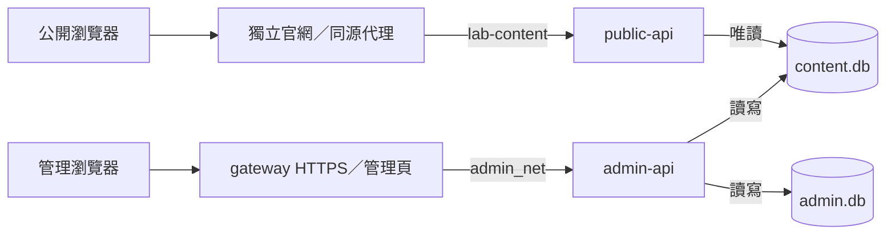

# 架構與核心要求

Python 3.14／FastAPI／Pydantic／sqlite3，原生HTML／CSS／JavaScript管理頁。維持八個功能模組與三個管理靜態檔，不增加重複多層架構。契約7.0.0、URL前綴/api/v1、SQLite格式9、LABSQL9備份。

本文只記設計與不可破壞的規則。完整[API](docs/API.md)、[欄位字典](docs/DATABASE.md)、[操作步驟](docs/OPERATIONS.md)及[實際檢查狀態](docs/IMPLEMENTATION_STATUS.md)各自維護，不在多份文件重複欄位定義。

以前端現有版面與展示需求決定內容欄位，後端提供所需資料，前端對接API；不為沿用舊資料模型而修改頁面樣式或保留沒有用途的內容欄位。帳戶、審計、編輯版本及備份屬於運作需求，仍需保留。

## 模組與閱讀順序

| 模組 | 職責／主要入口 |
|---|---|
| lab_backend/models.py | Pydantic模型、姓名排序、作者關聯及公開欄位；先讀此檔 |
| lab_backend/store.py | SQLite交易、CSV與容量驗證；Store.read/change/replace |
| lab_backend/public.py | 首頁、成員列表、單人詳情、論文列表四個GET |
| lab_backend/content.py | 三類共用CRUD、版本與表單schema |
| lab_backend/auth.py | Argon2、Cookie Session、帳戶及審計；build_user供網頁／CLI共用 |
| lab_backend/application.py | 兩個API入口、請求邊界、錯誤與健康檢查 |
| lab_backend/config.py | 環境設定，不在匯入時初始化資料 |
| lab_backend/cli.py | 空庫初始化、帳戶恢復、CSV、加密備份／恢復 |
| scripts/maintenance.py | 缺檔、靜態備份／恢復及監測，沿用CLI匯入規則 |
| scripts/sync_contracts.py | 真實路由→OpenAPI→公開前端型別 |
| admin_frontend/admin/ | index.html、app.js、style.css；七個功能頁共用API與表單 |

閱讀一次請求：`public.py → Store.read → 公開白名單 → JSON`；寫入則是`content.py → Store.change(operation) → 交易內授權／版本／關聯／容量檢查 → 內容與審計一起提交`。回呼operation執行時已持寫鎖。

Pydantic的`str | None`表示可空值，`Literal`限制選項，`Annotated/Field`限制長度與格式。業務模型、儲存歷史及公開投影分開，避免輸入操作者或洩漏私有欄位。管理頁的field/formFields依schema產生表單；accountForm共用帳戶表單，api統一Cookie／CSRF／錯誤。epoch/view阻止舊請求覆蓋新頁面；儲存期間鎖定欄位，失敗保留輸入。

## 資料與交易

SQLite是唯一執行來源，每次請求開新快照，只讀呼叫端明確要求的表，無靜態JSON回退或回應快取。content/content.db保存assets、people、publications；private/admin.db保存users、audit，共5表46欄。users為登入身份，people為網站成員，兩者不自動綁定。

- init只建空庫；內容經管理頁或明確CSV匯入。lab.json是真實私人參考，不讀取、複製到程式、提交Git或放進Docker。局部檢查只用合成資料。
- 全部內容儲存即公開，無草稿／發布／封存。研究方向、招募與固定文字由官網維護；無新聞、設定、UMPASS、瀏覽器上傳或媒體worker。
- 姓名分姓／名，照片存people.portrait。唯一可寫關聯是authors[].personId；publicationIds在同一快照反查，不雙向重複保存或依同名配對。公開不輸出created/updated或其時間，不暴露操作者。
- englishName為可留空的英文名；公開個人頁直接回相關publications，publicationIds只留在管理回應。首頁只回metadata.purpose=group_photo的全部合照、前三篇摘要及論文總數；已移除people.slug/sourceUrl/affiliation及publications.slug；管理歷史與版本仍保留。
- 論文內部按rowid升序讀取，API／管理列表／反查倒序，首頁取前三篇。UPSERT保留位置，CSV依列序新增，備份／恢復保持內部順序；不得自行VACUUM、重排或重建表。
- 30人／300篇是估算而非筆數上限。每表解碼及CSV各32MiB、內容單筆JSON252KiB；提交與離線預覽共用限制。審計分頁、串流封存，累積量不阻擋登入。

管理以admin.db為main，ATTACH content.db，同連線BEGIN IMMEDIATE＋DELETE journal＋FULL synchronous，內容與成功審計同次提交；SQL值參數綁定，表名取模型白名單。密碼雜湊在寫交易外執行，授權與版本在交易內重查。

公開mode=ro/query_only，固定快照後若見內容庫journal即503。恢復由管理程序在原環境／原掛載路徑處理，不刪日誌。僅支援單台Linux本機POSIX檔案系統、單一admin worker。admin.lock讓服務與離線維護互斥；備份／監測沿用同一非阻塞鎖實作。

## 部署與安全

兩API無主機端口。public-api只掛內容目錄唯讀；admin-api可寫兩庫；gateway不掛DB、不加入公開內容網路，預設127.0.0.1:9443。公開前端只連lab-content。三容器保留非root、唯讀rootfs、cap_drop、no-new-privileges及資源限制；無VPN前提或獨立DB容器。

public匿名唯讀、admin登入可寫，使用Argon2，無MD5、預設帳密、匿名註冊或恢復後門。保留HttpOnly／SameSite／HTTPS Secure Cookie、八小時記憶體Session、Origin／CSRF、每次帳戶狀態／角色檢查、停用／改密碼撤銷Session、兩個密碼運算併發額度及公開欄位白名單。身分檢查先於body解析，JSON拒絕未知欄位、重複鍵與非有限數字；body上限256KiB。UI隱藏不能取代後端授權。

憑證、Cookie、執行庫／journal、私人參考、匯出與備份不得進版控、映像或日誌。DB備份加密；靜態備份以版本、DB指紋及逐檔SHA256配對，拒絕穿越／符號連結並限制大小，恢復只建立新目錄。這是完整性核對，不是數位簽章。外部資產只列未驗證，不連外下載。

/healthz只看程序，/readyz讀內容，兩者不經官網代理。主機監測磁碟、備份失敗／過期／錯配及持續不可用，以JSON、stderr及退出碼告警。排程與外部通知需另行配置；完整防爆破、MFA／SSO及正式安全驗收尚未完成。

## 交付邊界

public_frontend是獨立Git子模組，固定提交、獨立部署；本機接線改動尚未提交／部署。路由數量不變，頁面欄位變更時需同步API文件、資料字典、兩份OpenAPI、管理頁與生成型別。舊庫／備份不隱式遷移、覆寫或刪除。

本階段只允許語法／匯入、暫存目錄及程序內ASGI局部回歸；不啟動Docker、HTTP listener或部署。正式瀏覽器、安全、負載與故障恢復驗收延後，狀態只記實際執行結果。
