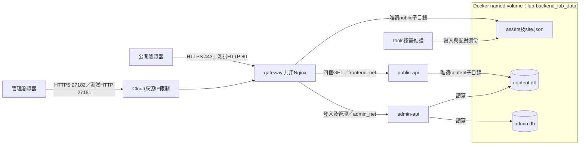

# 架構與核心要求

Python 3.14／FastAPI／Pydantic／sqlite3，原生HTML／CSS／JavaScript管理頁。維持八個功能模組與三個管理靜態檔，不增加重複多層架構。契約7.1.0、URL前綴/api/v1、SQLite格式10、LABSQL10備份。

本文只記設計與不可破壞的規則。完整[API](docs/API.md)、[欄位字典](docs/DATABASE.md)、[操作步驟](docs/OPERATIONS.md)及[實際檢查狀態](docs/IMPLEMENTATION_STATUS.md)各自維護，不在多份文件重複欄位定義。

以前端現有版面與展示需求決定內容欄位，後端提供所需資料，前端對接API；不為沿用舊資料模型而修改頁面樣式或保留沒有用途的內容欄位。帳戶、審計、編輯版本及備份屬於運作需求，仍需保留。

## 模組與閱讀順序

| 模組 | 職責／主要入口 |
|---|---|
| lab_backend/models.py | Pydantic模型、姓名排序、作者關聯及公開欄位；先讀此檔 |
| lab_backend/store.py | SQLite交易、CSV與容量驗證；Store.read/change/replace |
| lab_backend/public.py | 首頁、成員列表、單人詳情、論文列表四個GET |
| lab_backend/content.py | 三類共用CRUD、版本與表單schema |
| lab_backend/auth.py | Argon2、Cookie Session、帳戶及審計；build_user供網頁／CLI共用 |
| lab_backend/application.py | 兩個API入口、請求邊界、錯誤與健康檢查 |
| lab_backend/config.py | 環境設定，不在匯入時初始化資料 |
| lab_backend/cli.py | 空庫初始化、帳戶恢復、CSV、加密備份／恢復 |
| scripts/maintenance.py | 公開檔案安裝、固定設定白名單、缺檔、靜態備份／恢復及監測 |
| scripts/prepare_initial_data.py | 明確將前端首次來源轉成CSV＋公開檔案bundle，不開資料庫 |
| scripts/sync_contracts.py | 真實路由→OpenAPI→公開前端型別 |
| admin_frontend/admin/ | index.html、app.js、style.css；七個功能頁共用API與表單 |

閱讀一次請求：`public.py → Store.read → 公開白名單 → JSON`；寫入則是`content.py → Store.change(operation) → 交易內授權／版本／關聯／容量檢查 → 內容與審計一起提交`。回呼operation執行時已持寫鎖。

Pydantic的`str | None`表示可空值，`Literal`限制選項，`Annotated/Field`限制長度與格式。業務模型、儲存歷史及公開投影分開，避免輸入操作者或洩漏私有欄位。管理頁的field/formFields依schema產生表單；accountForm共用帳戶表單，api統一Cookie／CSRF／錯誤。epoch/view阻止舊請求覆蓋新頁面；儲存期間鎖定欄位，失敗保留輸入。

### 契約同步

開發環境使用Python3.14及requirements-dev.lock；以下在專案根目錄執行，不是VPS部署步驟：

```sh
python scripts/sync_contracts.py --check  # 僅比對兩份OpenAPI及前端型別
python scripts/sync_contracts.py          # 模型／路由變更後，明確重新生成
python scripts/check_basics.py            # 僅檢查匯入、契約及設定，不改檔
```

這些工具不啟動服務或讀取業務資料。生成會更新public_frontend/contracts/public-api.d.ts；該檔與前後端程式由同一Git倉庫管理，可一起提交，不能手改生成型別。

## 資料與交易

SQLite是業務內容唯一執行來源，每次API請求開新快照，只讀呼叫端明確要求的表，無靜態JSON回退或回應快取。content/content.db保存assets、people、publications；private/admin.db保存users、audit，共5表47欄。users為登入身份，people為網站成員，兩者不自動綁定。

- init只建空庫；內容經管理頁或明確CSV匯入。根目錄lab.json是真實私人參考，不讀取、複製、提交Git或放進Docker。使用者指定public_frontend/dist/data/lab.json及dist/assets為首次來源，seed僅在明確執行時掛唯讀來源，轉成CSV與公開檔案bundle；原始JSON不入Git，兩者不入映像、不在啟動時讀取。檢查只用合成資料。
- seed診斷只輸出例外類型、固定錯誤代碼及白名單提示；JSON語法錯誤可附行／欄數，不輸出原始例外、姓名、ID、來源中的實際檔名／路徑或Pydantic輸入。未知錯誤維持泛化；診斷改善不放寬來源驗證、檔案型別或既有輸出不得覆寫的規則。
- 靜態引用檔以lstat檢查型別及符號連結，讓權限錯誤保留為permission_denied；避免Python3.14的is_file回傳False而將目錄不可進入誤認為缺檔。seed掛載的dist本身及其子目錄須讓UID10001可進入，檔案可讀；不自動更改主機權限。
- 全部內容儲存即公開，無草稿／發布／封存。固定品牌、介紹及聯絡頁文字由後端維護工具管理public/site.json，公開官網只讀展示；不放people/publications、不作業務內容回退。沒有研究方向、招募、新聞、網站設定API或相關資料表，也沒有UMPASS、瀏覽器上傳或媒體worker。
- 畢業年月存people.alumniSince，為YYYY-MM或null；僅有至少一項身份且所有isCurrent=false的校友可填，其他必須null。管理API、CSV、恢復及讀取共用模型驗證；不補造日期、自動切換身份或靜默清除日期。成員列表與個人詳情均回傳此欄位。尚未正式部署，SQLite10只初始化新庫，不提供舊庫升級工具。
- 姓名分姓／名，照片存people.portrait。唯一可寫關聯是authors[].personId；publicationIds在同一快照反查，不雙向重複保存或依同名配對。公開不輸出created/updated或其時間，不暴露操作者。
- englishName為可留空的英文名；公開個人頁直接回相關publications，publicationIds只留在管理回應。首頁只回metadata.purpose=group_photo的全部合照、前三篇摘要及論文總數；已移除people.slug/sourceUrl/affiliation及publications.slug；管理歷史與版本仍保留。
- 論文內部按rowid升序讀取，API／管理列表／反查倒序，首頁取前三篇。UPSERT保留位置，CSV依列序新增，備份／恢復保持內部順序；不得自行VACUUM、重排或重建表。
- 30人／300篇是估算而非筆數上限。每表解碼及CSV各32MiB、內容單筆JSON252KiB；提交與離線預覽共用限制。審計分頁、串流封存，累積量不阻擋登入。

管理以admin.db為main，ATTACH content.db，同連線BEGIN IMMEDIATE＋DELETE journal＋FULL synchronous，內容與成功審計同次提交；SQL值參數綁定，表名取模型白名單。密碼雜湊在寫交易外執行，授權與版本在交易內重查。

公開mode=ro/query_only，固定快照後若見內容庫journal即503。恢復由管理程序在原環境／原掛載路徑處理，不刪日誌。僅支援單台Linux本機POSIX檔案系統、單一admin worker。admin.lock讓服務與離線維護互斥；備份／監測沿用同一非阻塞鎖實作。

## 部署與安全



三個常駐容器、兩個映像：gateway提供兩個前端及代理，public-api與admin-api共用Python映像但分開運行。兩API無主機端口，只監聽容器8000；public-api只連frontend_net、唯讀掛content子目錄，admin-api只連admin_net、掛完整volume到/data且可寫兩庫。gateway連兩內網，但只唯讀掛public子目錄，不能讀SQLite或private；tools按需維護或watch成為第四個常駐容器，不開listener、不掛Docker socket。

公開及管理入口使用不同listener與靜態根目錄：公開只代理固定四個GET到public-api，清除Cookie／Authorization、隱藏Set-Cookie，其他API及未知檔案路徑404；管理只代理auth/admin到admin-api，保留Cookie與CSRF。不能以公開端口、更換Host或改URL繞到管理路由。兩套請求限流、body限制及CSP各自保留，標頭不因Nginx的server繼承而互相污染。共用入口是明確的部署取捨：共用 Nginx 程序及站點私鑰，兩個入口有共同的故障與金鑰暴露風險，入口重啟同時影響官網與管理頁；兩個API的程序、網路及資料權限隔離仍保留，不能宣稱與兩個獨立Nginx完全等同。

不依賴.env、ADMIN_HOST或LAB_ADMIN_ORIGIN。lab.sh固定Compose專案名lab-backend並以--env-file /dev/null忽略舊.env，volume名與使用者現有部署相同，公開網路固定lab-content。HTTP明確用lab.sh http，其他命令預設HTTPS；不自動選端口或終止主機服務。HTTP映射80→8080與27181→27181；HTTPS映射443→8443與27182→27182。官網容器端口避開特權端口，管理端口內外相同；模式、Compose映射與Nginx生成片段由檢查共同核對。

管理入口取消固定Host白名單，可用實際IPv4或域名訪問，不再因ADMIN_HOST不符直接關閉連線。帳密與來源限制仍有效：每個非GET請求的Origin須等於部署模式的協定加實際Host（包含端口），拒絕缺少Origin、跨域、錯協定或錯端口；不信任X-Forwarded-Host／Proto或任意客戶端轉發IP。除登入外，寫入另需Session內的CSRF token。這是同源驗證，不是預先核准域名；任何解析至VPS的域名可打開登入頁，來源存取由Cloud控制，HTTPS瀏覽器仍須驗證憑證域名。

HTTP模式由Compose設定LAB_HTTP_TEST=true，使用lab_session_http_test、不設Secure，保留HttpOnly、SameSite=Strict、8小時Session、Argon2、每次帳戶狀態檢查及登入限流。正式模式明確false，使用__Host-lab_session與Secure，Origin必須https；模式錯拼拒絕啟動。LAB_DEV僅作loopback開發，不與HTTP測試同開。HTTP不加密帳密或Cookie，只供受控測試；HTTP不發HSTS、不跳轉HTTPS。切換模式／重啟後需重新登入。

public匿名唯讀、admin登入可寫，無MD5、預設帳密、匿名註冊或恢復後門。停用／改密碼撤銷Session，兩個密碼運算併發額度及公開欄位白名單保留。身分檢查先於body解析，JSON拒絕未知欄位、重複鍵及非有限數字；管理body上限256KiB。UI隱藏不能代替後端授權，完整防爆破及正式安全驗收仍待完成。

所有容器非root、唯讀rootfs、cap_drop=ALL、no-new-privileges並限制資源。gateway只在/tmp存設定與暫存，映像內自有程式／設定root擁有、目錄0755與檔案0644，切換USER10001後檢查可讀性；不改主機來源、TLS或volume權限。不以root執行或chmod777排錯。gateway建置只複製管理三檔、官網五檔及部署設定，不帶來源JSON、assets或私人資料；固定site.json及實體圖檔／PDF來自volume。

全專案只維護根.gitignore與.dockerignore。兩個映像共用根context、預設排除全部再逐檔放行程式，新增建置依賴須同步白名單。原始來源只在seed時唯讀掛載，不經builder；舊.env仍忽略且不自動刪除。沒有獨立DB容器，不在啟動時自動初始化或重建；不刪volume或journal排錯。單台Linux本機檔案系統，VPS只需Docker／Compose與可用維護控制台，不安裝主機Python或systemd排程；SSH關閉前須確認救援入口。

來源IP僅由Cloud防火牆／安全組管理，程式無IP清單。部署前限制管理端口、確認規則套用實際VPS／網卡；非標準端口不能取代登入或防火牆。僅IPv4直接連VPS，不經CDN或額外代理、不配置AAAA；驗證允許與不允許的來源，不能只看UFW。

正式 HTTPS 使用一張含 `casino.ye.wang` 和 `crab.ye.wang` 的 DNS SAN 憑證。兩個名稱開啟同一個官網（443），管理頁沿用這兩個名稱及 27182。完整憑證鏈及私鑰安裝到 secrets/public-tls 與 secrets/tls，兩處均唯讀掛載至 gateway。Cookie 可跨同主機端口，公開代理清除 Cookie，管理寫入仍檢查含端口的 Origin 及 CSRF。憑證金鑰、Cookie、執行庫／journal、匯出與備份須留在私人儲存。

`deploy/tls.sh sites` 用 Docker lego 的獨立快取一次申請兩個域名。切換成功後才更新 `active`，既有排程以 `renew` 接手。舊 `ip`、`domain`、`dual` 模式可在切換前繼續續期。上線後，gateway 僅將 443 上宣告 `acme-tls/1` 的專用握手分流到 edge 網路的臨時 lego。一般流量由 loopback 官網 TLS listener 處理，公開 API 按訪客來源 IP 限流。管理入口直接處理 TLS。首次上線前由 lego 直接綁定 443。工具持鎖核對 SAN、信任鏈與配對私鑰，更新兩處 PEM 並平滑重載，再以每個域名核對兩個端口的憑證指紋。帳號 B 選擇 OOS 或主機 cron 每 6 小時觸發續期檢查。[部署手冊](docs/OPERATIONS.md#https憑證與自動續期)

DB備份加密，靜態備份含assets與白名單site.json，以版本、DB SHA256與逐檔SHA256配對，拒絕穿越及符號連結並限制大小。這是完整性核對而非數位簽章；外部URL不連外下載。公開檔案僅SVG／PNG／JPEG／WebP／PDF，固定設定上限1MiB；首次安裝拒絕覆寫。CSV與靜態安裝是分開步驟，不宣稱跨DB／檔案原子提交；更換整個public目錄後force-recreate gateway以重新掛載subpath。

/healthz只看程序，/readyz讀內容，皆不經外部代理。tools從固定內網端點監測磁碟、備份失敗／過期／錯配及持續不可用，不依賴公開Host或外部HTTP代理。watch每60秒採樣，無主機排程；同volume備份仍須匯出異地。外部通知、自動備份、TLS自動化及整機停止監測另行配置。操作步驟集中OPERATIONS，狀態只記已執行的檢查。

## 交付邊界

public_frontend作為本專案普通資料夾，與後端一起提交；兩個前端由同一gateway提供。2026-11-19修正殘留gitlink，必要程式與目前契約以普通檔案納入主倉庫，部署設定集中deploy；索引暫存不代表已提交或推送。dist/data及dist/assets不加入Git，初始化來源另行受控提供。lab.sh在建置官網前檢查必要檔案，check_basics亦檢查Git索引，避免只有本機有檔案而部署副本缺失。已刪除的內附backend副本不恢復，正式後端只在根目錄lab_backend。設計預覽及舊來源契約只供本機參考，部署白名單不包含它們。路由數量、包裝、五表及欄位沒有改動；契約若變更，仍須同步文件、OpenAPI、管理頁與生成型別。舊庫／備份不隱式遷移、覆寫或刪除。

本階段只允許語法／匯入、暫存目錄及程序內ASGI局部回歸；不啟動Docker、HTTP listener或部署。正式瀏覽器、安全、負載與故障恢復驗收延後，狀態只記實際執行結果。
